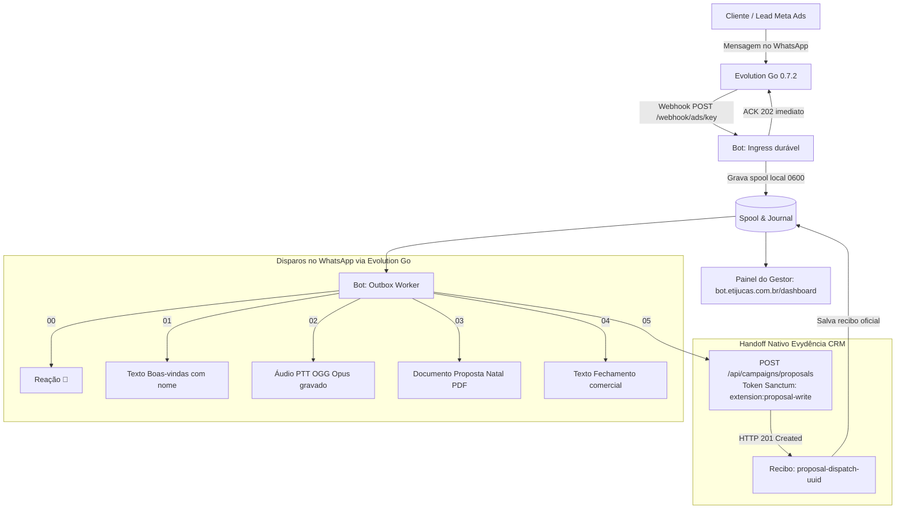

# Dossiê de Auditoria e Validação Cruzada — BotWhatsApp ↔ Evydência CRM (Natal 2026)

> **Data:** 27 de Outubro de 2026  
> **Repositório do Bot:** `hypeneural/botwhatsapp` (Branch: `fix/ctwa-native-proposal-handoff-20261027` / PR [#10](https://github.com/hypeneural/botwhatsapp/pull/10))  
> **Repositório do CRM:** `hypeneural/evydencia-crm` (Laravel / MySQL / Sanctum)  
> **Ambiente:** Produção VPS Contabo (`100.116.8.109` / `169.58.210.14`)  
> **Painel Ativo:** `https://bot.etijucas.com.br/dashboard`  
> **Número Oficial Ads CTWA:** `5548996425287` (`48 99642-5287`)  

---

## 1. Visão Geral da Arquitetura em Produção

O **BotWhatsApp** opera como um microserviço durável em Go 1.23, atuando entre a **Evolution Go 0.7.2** (gateway WhatsApp) e o **Evydência CRM** (backend Laravel).



### Contratos de Operação
1. **WhatsApp de Anúncios CTWA:** Exclusivamente `5548996425287`.
2. **Gatilhos de Anúncios Homologados (`config/ads-triggers.txt`):**
   - `"Quero conhecer os pacotes de Natal em Tijucas"`
   - `"Quero fotos do primeiro Natal do meu bebê"`
3. **Respeito a Opt-out e Pausa Humana:**
   - Palavra `"PARAR"` suspende permanentemente novos disparos de campanha.
   - Qualquer intervenção manual pausa o bot atômica e duravelmente via `internal/outbox/contact_update.go`.
4. **Cooldown de 24 horas (`BOT_ADS_FLOW_COOLDOWN_HOURS`):**
   - Impede que cliques repetidos no mesmo anúncio pelo mesmo contato reiniciem a série comercial.

---

## 2. Entregas e Correções Consolidadas na PR #10

1. **Substituição da API Legada 415/416 por Handoff Nativo Individual:**
   - O endpoint legado em lote `POST /api/campaigns/schedule/execute` com autorização genérica foi completamente descontinuado após o CRM bloquear campanhas 415/416 via `NatalProposalEntryPoint` (HTTP 422).
   - O bot agora consome o endpoint nativo de propostas utilizando token **Laravel Sanctum dedicado**, com escopo `extension:proposal-write` associado ao operador ID 2 (`can_send_proposals=true`), válido por 90 dias (toda a temporada de Natal 2026).
   - Evidência real em produção: Propostas aceitas com recibos oficiais gerados em segundos (ex: `proposal-dispatch-8fbfbae9-315b-4695-a364-966dea1ebedd`, `proposal-dispatch-6f0cddfe-5f95-4271-9a5c-9cec4beee3bf`, etc.).

2. **Segurança Reforçada e Princípio do Menor Privilégio:**
   - Proteção *fail-closed*: bot não sobe se o token Sanctum dedicado estiver ausente.
   - Bloqueio rígido de envio de token Bearer para qualquer domínio HTTPS diferente do host oficial do CRM.
   - O painel do gestor (`/dashboard`) exige autenticação HTTP Basic (`admin:<token>`), com headers estritos de segurança (`CSP`, `X-Frame-Options: DENY`, `no-store`).

3. **Resolução de Identidade e LIDs:**
   - Proibição absoluta de deduzir números de telefone a partir de LIDs (`@lid`).
   - Mapeamento estrito por `SenderAlt` ou histórico do mesmo JID.
   - Integração com a API de clientes do CRM (`GET /api/customers?phone=...` com `extension:customer-read`) para sincronizar nomes cadastrados, com cache seguro em disco (TTL 48h) e taxa limitada.

4. **Redesign do Painel do Gestor (`https://bot.etijucas.com.br/dashboard`):**
   - **Ocultação de Status/Stories por padrão:** Mensagens de difusão (`status@broadcast`) e grupos não poluem mais a tabela principal.
   - **Abas de Filtros Prioritários com Contadores em Tempo Real:**
     - 🎯 **Leads de Anúncios (CTWA):** Ativa por padrão, destacando leads de tráfego pago.
     - ⚠️ **Precisam de atenção:** Falhas, bloqueios locais ou rejeições.
     - ✅ **Propostas aceitas:** Apenas propostas confirmadas pelo CRM com recibo.
     - 💬 **Todas as conversas privadas:** Visão consolidada de clientes 1 a 1.
     - 📦 **Ver tudo:** Para auditoria forense completa.
   - **Recursos Comerciais:**
     - Link direto no telefone com ícone do WhatsApp para abrir a conversa no WhatsApp Web (`https://wa.me/55...`).
     - Botão de cópia rápida do recibo do CRM (`proposal-dispatch-...`) com confirmação visual (*"✓ Copiado"*).
     - Timeline vertical interativa para expansão das etapas da API.
     - Correção de estado em voo: requisições ativas (< 2 min) aparecem como `Em andamento`, eliminando alarmes falsos de "incerto".

---

## 3. Dossiê para Consultoria e Validação Cruzada pelo ChatGPT

> [!TIP]
> **Instruções para o Gestor:**  
> Copie o bloco de texto abaixo e envie na conversa com o **ChatGPT** (que possui acesso ao repositório `hypeneural/evydencia-crm`). Ele realizará a auditoria no código do CRM e responderá às perguntas técnicas.

---

### 📋 [INÍCIO DO PROMPT PARA O CHATGPT]

**Assunto: Auditoria Cruzada de Integração — BotWhatsApp CTWA (PR #10) ↔ Evydência CRM (Laravel Natal V4)**

Olá, ChatGPT! Atuo na engenharia do **BotWhatsApp** (`hypeneural/botwhatsapp`). Recentemente finalizamos e implantamos em produção a **PR #10** (branch `fix/ctwa-native-proposal-handoff-20261027`), responsável por integrar o fluxo de anúncios Click-to-WhatsApp (Meta Ads / Instagram) da campanha de Natal 2026 com o **Evydência CRM** (`hypeneural/evydencia-crm`).

Como você tem acesso integral ao repositório `hypeneural/evydencia-crm`, precisamos da sua assessoria técnica e validação cruzada no código do CRM para certificar a consistência dos contratos, permissões, banco de dados e regras de negócio.

---

### 1. Resumo da Implementação no BotWhatsApp:

1. **Instância e Gatilhos:**
   - WhatsApp oficial de anúncios: `5548996425287`.
   - Gatilhos de anúncio aprovados: `"Quero conhecer os pacotes de Natal em Tijucas"` e `"Quero fotos do primeiro Natal do meu bebê"`.
2. **Funil de Atendimento:**
   - Quando o lead clica no anúncio, o bot envia sequencialmente: Reação `🎄` -> Texto de boas-vindas com o nome -> Áudio gravado PTT OGG Opus -> Documento Proposta Natal PDF -> Texto de fechamento comercial.
3. **Envio da Proposta ao CRM (Substituição da API 416 Legada):**
   - Descontinuamos o endpoint legado `POST /api/campaigns/schedule/execute` (que foi bloqueado pelo CRM via `NatalProposalEntryPoint` com HTTP 422).
   - O bot agora realiza uma chamada HTTP autenticada com token **Laravel Sanctum dedicado**:
     - **Método / Rota:** `POST /api/campaigns/proposals`
     - **Header:** `Authorization: Bearer <SANCTUM_TOKEN>` (token emitido com ability `extension:proposal-write` para o operador ID 2 com `can_send_proposals=true`, validade 90 dias).
     - **Header:** `Content-Type: application/json`, `Accept: application/json`
     - **Payload enviado:**
       ```json
       {
         "crm_phone": "4896995515",
         "instance_id": "50e7ab4d-a380-42be-ab8a-d85fa982bfec",
         "contact_name": "Sheila",
         "campaign_id": 416,
         "source": "meta_ads"
       }
       ```
     - **Resposta obtida:** O CRM retorna `HTTP 201 Created` contendo o ID/recibo de despacho (ex: `proposal-dispatch-8fbfbae9-315b-4695-a364-966dea1ebedd`).
4. **Sincronização de Nomes de Clientes:**
   - O bot consome a rota `GET /api/customers?phone=4896995515` utilizando token Sanctum com ability `extension:customer-read`, armazenando o nome oficial do cliente em cache local seguro (TTL 48h) para exibição no painel gerencial em `https://bot.etijucas.com.br/dashboard`.

---

### 2. Checkpoints para Você Auditar no Repositório `hypeneural/evydencia-crm`:

Por favor, inspecione os arquivos do backend Laravel do CRM (especialmente `routes/api.php`, `app/Http/Controllers/Api/`, `app/Services/Proposals/`, `app/Models/` e `database/migrations/`) e nos responda às seguintes questões:

#### Questão 1: Contrato do Endpoint de Propostas Nativo
* Inspecione a rota e o FormRequest responsáveis por receber a proposta individual (ex: `POST /api/campaigns/proposals` ou similar).
* O payload enviado pelo bot (`crm_phone`, `instance_id`, `contact_name`, `campaign_id`, `source`) preenche todos os requisitos necessários para criar a proposta e vincular as atividades de atendimento na esteira V4 de Natal?
* Há algum parâmetro adicional recomendado que deveríamos enviar para enriquecer os relatórios do CRM (como UTM source, ad_id da Meta Ads ou tags de campanha)?

#### Questão 2: Validação da Ability Sanctum e Operador
* Inspecione as permissões exigidas no controller/middleware do Laravel para essa rota.
* A ability `extension:proposal-write` atribuída ao operador ID 2 atende estritamente às regras de segurança sem conceder permissões desnecessárias no CRM?
* Como o CRM lida com tokens Sanctum expirados após 90 dias? Existe algum evento ou comando no Laravel que devamos observar para renovação programada?

#### Questão 3: Reconciliação dos 13 Leads Históricos (HTTP 422)
* Antes da ativação do endpoint nativo, 13 leads de teste/anúncio foram atendidos no WhatsApp mas receberam `HTTP 422 (natal_proposal_native_entry_required)` pelo endpoint legado 416.
* Consultando o banco de dados e as regras do CRM, qual é o procedimento mais limpo e seguro para registrar esses 13 leads no CRM:
  - (a) Reenviar as propostas via script utilizando o novo endpoint nativo?
  - (b) Inseri-los via comando Artisan / Tinker diretamente no Laravel?
  - (c) Cadastrá-los manualmente através da interface web `/gestao/natal/proposta`?

#### Questão 4: Rota de Consulta de Clientes (`extension:customer-read`)
* Inspecione a rota utilizada para obter o contexto do cliente por telefone (`GET /api/customers?phone=...`).
* Essa consulta utiliza índice otimizado no banco para buscas pelo formato nacional (`489...` ou `55489...`)?
* Há alguma limitação de taxa (rate limit / throttle) configurada nessa rota no Laravel que o cache local de 48h do bot deva respeitar?

#### Questão 5: Idempotência e Concorrência sob Escala
* Quando a campanha de tráfego pago da Meta Ads estiver em pico (múltiplos leads clicando no anúncio no mesmo minuto), o CRM possui mecanismo de lock pessimista, restrição de unicidade (`unique index`) ou trava de concorrência por telefone/campanha para evitar agendamentos duplicados caso o bot efetue retry após timeout de rede?

---

Por favor, forneça uma análise técnica aprofundada, indicando os arquivos exatos, classes e migrations correspondentes no repositório `hypeneural/evydencia-crm`.

---
### 📋 [FIM DO PROMPT PARA O CHATGPT]
