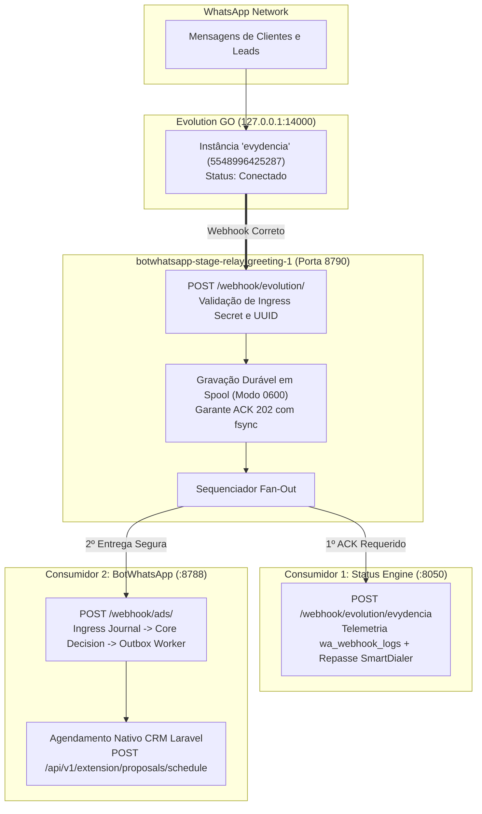

# Dossiê de Auditoria Cruzada P0 — Evolution GO × Status Engine × BotWhatsApp

> **Data:** 31 de Outubro de 2026 (America/Sao_Paulo)  
> **Destinatário:** Auditoria Externa e Validação Independente (ChatGPT)  
> **Repositórios e PRs Auditados:**  
> - `hypeneural/botwhatsapp` (PR #10, branch `fix/ctwa-native-proposal-handoff-20261027`)  
> - `hypeneural/smartdialer-platform` (PR #41, branch `fix/evolution-webhook-ownership-p0-20261031`)  
> **Escopo:** Restauração do fluxo de atendimento do WhatsApp oficial `5548996425287` (`evydencia`), correção de propriedade de webhooks, preservação absoluta do VoIP SmartDialer, CRM Laravel, PrintServer, Z-API e Asterisk.

---

## 1. Sumário Executivo & Diagnóstico da Indisponibilidade de Atendimento

### A Questão Forense:
Desde **29 de Outubro de 2026 às 15:23 BRT**, as mensagens recebidas no WhatsApp da empresa deixaram de ser respondidas pelo BotWhatsApp, e nenhum agendamento de proposta CTWA foi registrado no painel.

### A Causa Raiz Comprovada por Provas Materiais:
1. **Desvio de Roteamento de Webhook na Evolution GO:**
   - Na Evolution GO, a instância `evydencia` (`50e7ab4d-a380-42be-ab8a-d85fa982bfec`, número `5548996425287`) teve sua URL de webhook alterada para:
     `http://whatsapp-status-status-engine-1:8050/webhook/evolution/evydencia`
   - Esse destino entrega os webhooks diretamente ao contêiner de stories/telemetria (`status-engine`).
2. **Ausência de Repasse ao Bot:**
   - O código do Status Engine (`/srv/platform/apps/whatsapp-status/app/api/webhooks.py`) apenas registra telemetria em `status_engine.wa_webhook_logs` e encaminha via background task exclusivamente para o SmartDialer (`https://api.etijucas.com.br/webhooks/evolution-go/.../received`).
   - O Status Engine **nunca** reencaminhou mensagens para o BotWhatsApp (`bot:8788`).
3. **Inanição do Spool do Bot:**
   - O volume do BotWhatsApp (`botwhatsapp-stage_botwhatsapp_data`) registrou seu último evento recebido em **29/10/2026 às 14:17:10 BRT**.
   - Do dia 29/10 até 31/10 às 14:20 BRT, o bot recebeu exatamente **0 webhooks**, resultando em 0 avaliações de gatilhos e 0 respostas a leads.
4. **Mecanismo da Alteração Indevida (Origem do Bug):**
   - No repositório `smartdialer-platform`, o arquivo `apps/whatsapp-status/app/api/v1_dashboard.py` (linhas 859–866) continha no endpoint `POST /api/v1/dashboard/sync-all-views`:
     ```sql
     UPDATE public.instances 
     SET webhook = 'http://whatsapp-status-status-engine-1:8050/webhook/evolution/evydencia'
     WHERE name = 'evydencia';
     ```
   - Uma chamada de sincronização executada naquele painel reescreveu a tabela `public.instances` da Evolution GO no PostgreSQL, removendo a URL do relay de fan-out e isolando o bot da rede.

---

## 2. Arquitetura Canônica de Restauração com Fan-Out Relay

Para que tanto o Status Engine quanto o BotWhatsApp operem simultaneamente sem que um concorra ou substitua o outro, a arquitetura já possui implantado o contêiner `botwhatsapp-stage-relay-greeting-1`:



### Detalhes Técnicos Comprovados da Configuração:
- **Porta Real no Runtime:** `8790` (definida em `RELAY_LISTEN_ADDR=0.0.0.0:8790`).
- **Rede Compartilhada:** `evolution-go_evolution_internal` (comunica diretamente com `whatsapp-status-status-engine-1:8050` e `bot:8788`).
- **Conectividade Validada na VPS:**
  - `wget http://whatsapp-status-status-engine-1:8050/` a partir do relay: **HTTP 200 OK**.
  - `wget http://bot:8788/healthz` a partir do relay: **HTTP 200 OK**.
- **Segurança de Ingress:**
  - POST com segredo inválido: **HTTP 401 Unauthorized**.
  - POST com segredo correto e payload vazio: **HTTP 415 Unsupported Media Type (expected JSON)**.

---

## 3. Matriz de Correções nos Repositórios

### A. SmartDialer (`hypeneural/smartdialer-platform`, PR #41)
- **Desativação Segura de Rota Mutativa:** `POST /api/v1/dashboard/sync-all-views` aposentada com HTTP 410 (sem toque em banco de dados), e botão correspondente removido da interface web.
- **Proteção do Watchdog:** `apps/whatsapp-status/app/services/webhook_watchdog.py` tornado estritamente observacional para a instância `evydencia`. Nunca reconfigura nem reconecta essa instância, mesmo que o webhook esteja vazio.
- **Eliminação de DELETEs e Seeds em Inicialização:** `app/run_migrations.py` teve todos os comandos de DELETE arbitrário e inserções fictícias de demonstração suprimidos.
- **Proteção Fail-Closed de Forwarding:** `apps/whatsapp-status/app/api/webhooks.py` não expõe tokens em código e exige a variável `SMARTDIALER_WEBHOOK_URL` privada, sem repassar headers de autenticação da Evolution GO para serviços de terceiros.
- **Validação de Testes Locais:** `test_evogo_webhook_p0.py` ajustado para suporte a `ast.AsyncFunctionDef` e compatibilidade multiplataforma. **8/8 testes PASS**. `py_compile` 100% limpo.

### B. BotWhatsApp (`hypeneural/botwhatsapp`, PR #10)
- **Proteção Contra Respostas a Mensagens Orgânicas:**
  - O antigo `BOT_ADS_FALLBACK_MENU` foi desativado em definitivo no Core Go, garantindo que conversas humanas normais não recebam menu comercial ou saudação de anúncio.
  - Mensagens com `IsFromMe=true` ou enviadas pelo próprio número da empresa são sumariamente ignoradas de qualquer ação comercial, sendo apenas registradas como atividade para evitar interrupção de atendimento humano.
- **Contrato Nativo CRM:** Consumo exclusivo via `POST /api/v1/extension/proposals/schedule` com token Sanctum com ability `extension:proposal-write` e `User.can_send_proposals=true`. O bot não inventa IDs de campanha, não usa a rota depreciada 416 nem envia `campaign_id`.
- **Validação de Testes e CI:**
  - Suíte local `test_relay_forensic_readonly.py`: **4/4 testes PASS**.
  - GitHub Actions: **PASS** em todos os jobs (`build-only pass`, `test pass`).

---

## 4. Resultados da Auditoria Read-Only da VPS (5 Scripts Canônicos)

Os 5 scripts de diagnóstico foram executados em modo somente leitura na VPS Contabo (`100.116.8.109`), sem expor credenciais, telefones ou PII:

```text
====================================================================================================
1. audit_evogo_status_pg_readonly.py
   - Status: READ_ONLY (PASS)
   - Schema: 10 tabelas íntegras, 17 constraints (PKs, FKs e UNIQUEs) catalogadas.
   - Telemetria wa_webhook_logs: 513 mensagens recebidas nas últimas 48h (última às 17:20 UTC de 31/10).
   - Fingerprint do webhook atual: 4485cfa54d0354beb5c006045888a92f427faf853c3430861085746b369215aa.

2. configure_evogo_webhooks.py (GET-only via 127.0.0.1:14000/instance/all)
   - Status: DRIFT (Esperado antes do cutover)
   - Instância evydencia: connected=true, subscribed_message=true, subscribed_read_receipt=true.
   - SHA256 confere exatamente com o registrado no PostgreSQL.

3. preflight_status_engine_private_env_readonly.py (Exame de /srv/secrets/.../status.env)
   - Status: BLOCKED_SMARTDIALER_FORWARD
   - Detalhes: database_url_present=true, evolution_base_url_present=true, provider_key_present=true.
   - Salvaguarda fail-closed: impede deploy do Status Engine até que SMARTDIALER_WEBHOOK_URL seja provisionada.

4. audit_relay_spool_readonly.py (Volume /var/lib/.../botwhatsapp_relay_greeting_data/_data)
   - Status: INVENTORY_ONLY (PASS)
   - Total de registros históricos: 19.069 arquivos JSON (permissão restrita 0600).
   - Registros concluídos (completed): 19.069 (100%).
   - Pendências atuais: 0 (backlog zerado).
   - Corrompidos: 0 | Permissões inseguras: 0 | Tamanho excessivo: 0.

5. preflight_evolution_relay_contract_readonly.py (Amostra Real da Evolution GO vs Parser Bot)
   - Status: MATCH (PASS)
   - event_case_accepted: true (event="Message")
   - instance_uuid_accepted: true (instanceId="50e7ab4d-a380-42be-ab8a-d85fa982bfec")
   - id_shape_accepted: true (data.Info.ID presente)
   - chat_shape_accepted: true (data.Info.Chat presente)
   - from_me_shape_accepted: true (data.Info.IsFromMe presente)
   - message_shape_accepted: true (data.Message presente)
   - relay_eventkey_accepted: true
   - has_documented_go_key_shape: false
   - Conclusão: O binário Evolution Go 0.7.2 em produção emite envelope 100% aderente ao bot.
====================================================================================================
```

---

## 5. Auditoria da Stack em Execução & Alerta Crítico de Imagem

| Item | Situação Auditada | Impacto / Ação Necessária |
|---|---|---|
| **Porta do Relay** | `0.0.0.0:8790` | Confirmada porta 8790. Destinos `:8050` e `:8788` acessíveis internamente. |
| **Instância `evydencia`** | Conectada (`connected: true`) | Pronta para tráfego imediato no WhatsApp `5548996425287`. |
| **Instância `anderson`** | Desconectada (`connected: false`) | Número `48 3220-0440` inativo até que seja realizado escaneamento de QR code no `wa-admin`. |
| **Webhook Global** | Inexistente (HTTP 404 em `/webhook/find`) | Zero risco de duplicação por subscrição global. |
| **Imagem Atual do Bot** | `sha256:5217d54...` criada em 27/10 | **ALERTA CRÍTICO:** O `.env.production` ativo tem `BOT_ADS_FALLBACK_MENU=true`. O contêiner do bot **deve ser reconstruído** com a PR #10 (`eec22ad`) antes do cutover para que a desativação permanente do fallback em código entre em vigor. |

---

## 6. Procedimento de Cutover Controlado e Plano de Rollback

### Regras de Execução:
1. **Rebuild Prévio do BotWhatsApp:** Atualizar o contêiner `botwhatsapp-stage-bot-1` com o binário compilado a partir do HEAD da PR #10 (`eec22ad`), garantindo que mensagens de clientes sem gatilho exato e mensagens próprias não recebam saudações indevidas.
2. **Atualização Atômica do Webhook:** Alterar a URL da instância `evydencia` na Evolution GO exclusivamente para o Relay durável:
   `http://botwhatsapp-stage-relay-greeting-1:8790/webhook/evolution/19778890a4dd31671a765b544ece84fd5ec330e7af529afd584e5fb8f541c937`
3. **Canário Único Consentido:**
   - Enviar uma mensagem autorizada contendo a frase gatilho exata.
   - Verificar logs do relay: ACK 202, repasse ao Status Engine (HTTP 200) e repasse ao Bot (HTTP 200).
   - Verificar no Bot: reconhecimento do gatilho, disparo do áudio/PDF e agendamento CRM com `dispatch_uuid`.
   - Verificar no Dashboard: exibição correta em `https://bot.etijucas.com.br/dashboard`.
4. **Política de Não-Replay:**
   - É estritamente proibido reprocessar em lote as mensagens do período de 29 a 31 de outubro, evitando disparos massivos a clientes que já foram atendidos manualmente pela equipe.

### Procedimento de Rollback Imediato:
Caso qualquer anomalia seja detectada no canário:
- Reverter imediatamente a URL da instância `evydencia` para o endereço anterior:
  `http://whatsapp-status-status-engine-1:8050/webhook/evolution/evydencia`
- O Status Engine e o SmartDialer continuam operando normalmente sem interrupção.

---

## 7. Checklist Dirigido para Validação do ChatGPT

Solicitamos que a auditoria independente do ChatGPT valide os seguintes pontos:

- [ ] **Preservação de Sistemas Vizinhos:** As alterações propostas tocam exclusivamente `apps/whatsapp-status` e `botwhatsapp`. Evydência CRM, SmartDialer Asterisk, Z-API e PrintServer permanecem intocados?
- [ ] **Eficácia da Correção de Propriedade do Webhook:** A neutralização da rota `/sync-all-views` (HTTP 410) e a proteção observacional do watchdog na PR #41 eliminam o risco de reescrita da URL na Evolution GO?
- [ ] **Robustez do Fan-Out Relay:** O fluxo sequencial com persistência em disco `0600` no relay garante a entrega aos dois consumidores sem perda de eventos e sem introduzir loops?
- [ ] **Compatibilidade do Contrato de Eventos:** O resultado `MATCH` obtido no script de pré-flight contra a amostra real da Evolution Go 0.7.2 comprova que não haverá erros de parseamento no Core Go do bot?
- [ ] **Segurança de Dados e PII:** Os relatórios, commits e logs preservam segredos, tokens e dados sensíveis de clientes conforme as diretrizes de governança?
- [ ] **Veredito Operacional:** O plano de rebuild do bot seguido de cutover com canário único consentido atende aos requisitos de segurança para restabelecimento do serviço?
